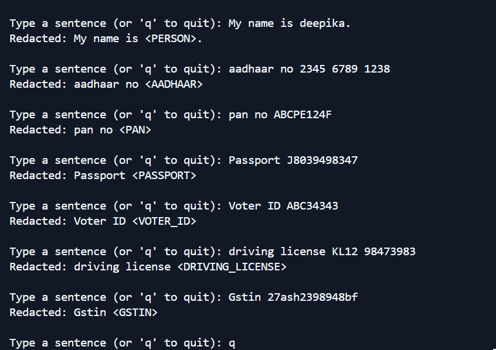

# PII Redaction for Typed Text

A local command-line tool that finds personal information in typed English text and replaces each item with a labelled tag. It is built on [Microsoft Presidio](https://github.com/microsoft/presidio) and spaCy, with added recognizers and rules for Indian identity documents.

Nothing is sent over the network. All processing runs on your machine.



## What it tags

| Input | Output |
|---|---|
| `My name is deepika.` | `My name is <PERSON>.` |
| `aadhaar no 2345 6789 1238` | `aadhaar no <AADHAAR>` |
| `pan no ABCPE124F` | `pan no <PAN>` |
| `Passport J8039498347` | `Passport <PASSPORT>` |
| `Voter ID ABC34343` | `Voter ID <VOTER_ID>` |
| `driving license KL12 98473983` | `driving license <DRIVING_LICENSE>` |
| `Gstin 27ash2398948bf` | `Gstin <GSTIN>` |

The keyword (such as `passport`, `pan` or `Gstin`) is kept, and only the value after it is replaced.

Other tags:

- Phone numbers become `<phone>`.
- Bank account numbers become `<bank_no>`.
- Other US identifiers drop the `US_` prefix, for example `<SSN>`, `<ITIN>`.
- Names, emails, card numbers, IP addresses, URLs, dates and locations use the Presidio tag names, for example `<PERSON>`, `<EMAIL_ADDRESS>`.

## Indian identifiers

Recognizers in [indian_recognizers.py](indian_recognizers.py):

- **Aadhaar**: 12 digits, first digit 2 to 9, checked with the Verhoeff checksum.
- **PAN**: five letters, four digits, one letter.
- **Passport**, **voter ID**, **driving licence** and **GSTIN**: format-based patterns.

Keyword rules in [redact.py](redact.py) tag the value after `passport`, `voter ID`, `driving licence`, `PAN` or `GSTIN`, even when the value is malformed. The value must be at least four characters and contain a digit.

## Setup

The project uses [uv](https://docs.astral.sh/uv/). From the repository root:

```bash
uv sync
```

If the spaCy English model is missing, install it with:

```bash
uv run python -m spacy download en_core_web_lg
```

## Run

```bash
uv run python redact.py
```

Type a sentence and press Enter. Type `q` to quit. Use `uv run`, not a bare `python`, so the project's virtual environment is used.

## How it works

1. The sentence goes to the Presidio analyzer, which runs spaCy's named-entity recognizer, the built-in pattern recognizers and the Indian recognizers.
2. Keyword rules add matches for document values.
3. Filters remove known spaCy errors: digit-only names, places or dates, and single document keywords. A phone-shaped match in 3-2-4 format is relabelled as an SSN.
4. Overlapping matches are resolved so that one label is kept per piece of text. Identifier patterns win over phone numbers, and phone numbers win over spaCy matches.
5. The anonymizer replaces each kept span with its tag.

`US` and `USA` are not tagged, because they name countries.

## Project report

The subject report is in the `REPORT` folder: [REPORT/CL REPORT.docx](REPORT/CL%20REPORT.docx).

## Known limitations

- English text only. Code-mixed text (for example English-Hindi) is not handled.
- Medical licence numbers are not verified. A sample medical licence number is tagged `<DRIVER_LICENSE>` instead.
- Aadhaar numbers starting with 0 or 1 are not matched. There is no Aadhaar keyword rule yet.
- A 3-2-4 hyphenated number is treated as an SSN. Some valid-looking test values, such as `123-45-6789`, are not tagged because Presidio rejects them as invalid.
- The keyword rules tag any digit-containing value after a keyword.
- Names without a surname, or in lowercase, may be missed.
- No labelled evaluation has been run. Accuracy, precision, recall and F1 are not reported.

## Repository note

This repository also contains `presidio_evaluator`, a framework for evaluating Presidio's PII detection. `redact.py` and `indian_recognizers.py` are standalone and do not depend on it.
